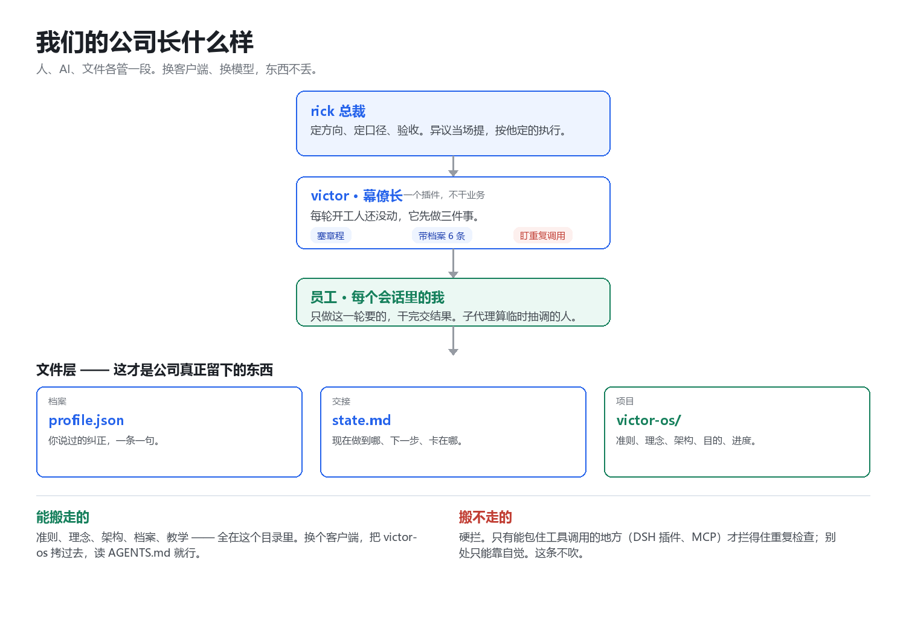

# victor-os

把一个团队打包成目录：准则、理念、架构、进度各一份 md。任何 AI 客户端——DSH、Claude、Grok、本地模型——读完就能上岗，不用从头教。

这不是提示词合集，是**交接包**。人走了，东西还在；换个客户端，东西也还在。

## 三种用法

1. **有文件系统的客户端**（DSH、Claude Code、Cursor）：把目录放进项目，工具会自动读根目录的 `AGENTS.md`。
2. **只能贴提示词的**（Grok 网页版、Claude 网页版）：把 `victor.md` 整个贴进系统提示或自定义指令。
3. **只能读一段的**：至少贴 `02-charter.md`，那是底线。

## 里面有什么

| 文件 | 是什么 | 谁维护 |
|---|---|---|
| `AGENTS.md` | 入口。跨工具开放格式，6 万+ 项目在用 | 手写 |
| `00-purpose.md` | 我们为什么存在 | 手写 |
| `01-principles.md` | 公司理念 | 手写 |
| `02-charter.md` | 员工准则，每轮都要守 | 自动生成 |
| `03-architecture.md` | 谁是谁、什么能搬什么搬不走 | 手写 |
| `04-state.md` | 当前进度，接新活先读 | 手写，随项目更新 |
| `victor.md` | 上面几份拼成的一份，给贴不了文件的地方 | 自动生成 |
| `diagram.png` | 架构导图 | 自动生成 |

## 怎么更新

准则的源头在插件 `dsh-victor/index.js`。改完跑：

```
node dsh-victor/export.mjs
```

`02-charter.md`、`victor.md`、`diagram.png` 一起刷新。这三样别手改，会被覆盖。

## 版本

当前 **v0.1.0**，内容对应插件 `dsh-victor` v0.2.0。每次改动记进 [CHANGELOG.md](CHANGELOG.md)，版本号只往前走。


